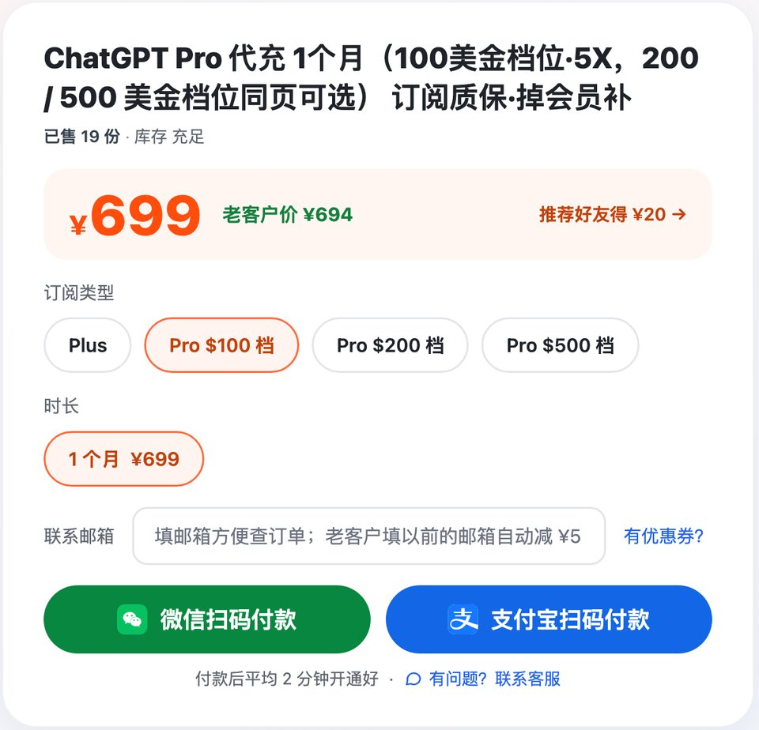
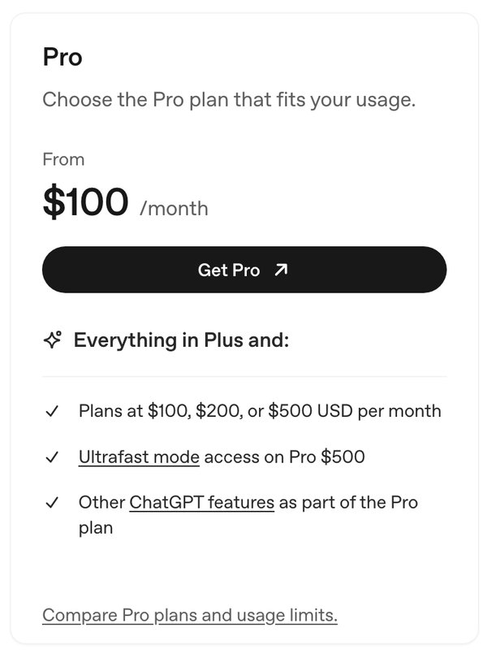
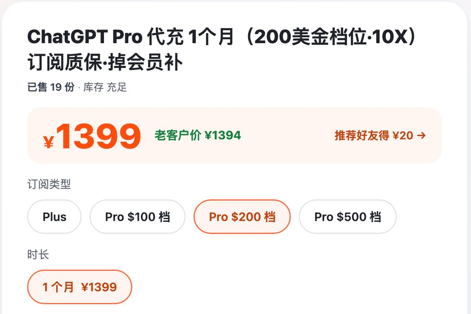

# ChatGPT Pro价格 2026：100/200/500 美金三档区别

> 2026-10-30 更新 · 瑶瑶ai训练师（kw.yaoyao.chat 店主）整理 · 文中商城链接为广告

**先说结论：** 国内开 Pro，找瑶瑶ai训练师的商城：[ChatGPT Pro ¥699（100美金档位）](https://kw.yaoyao.chat/item/17?utm_source=github&utm_medium=readme&utm_campaign=gpt-pro&utm_content=top)，开的是你账号上的官方 Pro。官方送 Pro 的 API 额度，代充开的也能领（订阅满 7 天、第一笔按剩余天数折算，条件见下文）；付款后在订单页贴登录信息，不要密码，平均 2 分钟开通，没开成重开或退款，本期掉会员补一个月。下单填券码 **888888** 再减 ¥3。

- **三档多少钱**：官方 100 / 200 / 500 美元一个月，只按月付；瑶瑶店里 ¥699 / ¥1,399 / ¥3,499，同一页选档。
- **10 月 29 日刚调过**：Pro 100、500 的 Work 和 Codex 额度翻倍，Pro 200 降额取消，月费没变。
- **手上的 Plus 没到期**：先问企业微信怎么衔接再下单，直接提交会提示"已有订阅"。
- **谁不用买**：从没撞过 Plus 上限的，每月 20 美元的 Plus 就够。

*图：瑶瑶商城 Pro 下单区，三档在同一排切换（kw.yaoyao.chat/item/17，2026-10-30 截图）*

## ChatGPT Pro价格和三档逐项对比

官方部分照帮助中心《About ChatGPT Pro tiers》、Codex 定价页和 API 额度福利页整理（2026-10-30 核对），美元标价、不含税，实际扣款以官方结算页为准；店里的价格取自 2026-10-30 的商城数据库，以下单页为准。

| 对比项 | Pro 100 | Pro 200 | Pro 500 |
|---|---|---|---|
| 官方月费 | 100 美元 | 200 美元 | 500 美元 |
| 瑶瑶店里一个月 | ¥699 | ¥1,399 | ¥3,499 |
| 包含用量（官方原话） | 三档里最少 | 比 Pro 100 多 | 三档里最高 |
| Work 和 Codex 额度（10-29 起） | 翻倍 | 降额取消，原来低的翻倍拉平 | 翻倍 |
| 聊天里 GPT-6 Pro 每周条数 | 不变 | 低的提到和高的一样 | 不变 |
| Codex 5 小时限制 | 目前没有，每周限制可能有 | 同左 | 同左 |
| Fast 模式 | 按 2.5 倍扣额度 | 同左 | 同左 |
| Ultrafast 极速 | 没有 | 没有 | 有，按 8 倍扣套餐额度 |
| 买 credits 能解锁 Ultrafast 吗 | 不能 | 不能 | 本来就有 |
| API 额度福利（完整一期；第一笔折算，领取条件见 Plus 对比表） | 100 美元 | 200 美元 | 500 美元 |
| 计费 | 只按月 | 只按月 | 只按月 |
| 一般适合 | Plus 一周撞好几次上限 | Pro 100 也常撞每周上限 | 额度够、嫌等结果慢 |

表下面几句，读表时别漏：

- **功能三档一样：** Pro 模型、Codex、深度研究、图片生成、记忆、文件上传都有。多付的钱买的是用量和速度。
- **两本账分开算：** Work 和 Codex 是一本，聊天里 GPT-6 Pro 的每周条数是另一本。10 月 29 日翻倍的是前一本，Pro 100 和 Pro 500 的后一本没动。卡你的要是聊天条数，这次的翻倍帮不上。
- **Fast 和 Ultrafast 的倍数是扣额度的倍率**，官方专门说了不保证一定更快。Ultrafast 支持 GPT-6 Astra 和 GPT-6.1 Sol，套餐额度扣完再按标准 credits 价的 6 倍从 credits 余额里扣。
- **到顶了会怎样：** 对应模型暂时用不了，ChatGPT 会显示几点恢复。这不是封号，订阅也照常。客服重置不了额度，能帮你查的是用量算错了、或者到点还没恢复。不想等，到 Settings → Usage 买 credits，能接着用 Codex、ChatGPT Work 和 Word、Excel、PowerPoint 插件，但不是每个模型和功能都能靠 credits 加量。
- 定价页 Pro 卡片写着"起价"，是因为最低一档 100 美元。Pro 是个人订阅，共享账号官方明确禁止；几个人用，看 Business：2 人起，年付每人每月 20 美元，月付 25 美元（Codex 定价页）。

*图：OpenAI 官方 Codex 定价页截图（learn.chatgpt.com/docs/pricing，2026-10-30）。From 就是"起价"，卡片里写明三档 100 / 200 / 500 美元，Ultrafast 只给 Pro 500*

## 10 月 29 日的调整：Pro 200 的额度不降了

先理一下时间：Pro 500 是 9 月 29 日新推出的一档；Pro 200 眼下重新开放新订阅（发布说明 9-29 条目、《About ChatGPT Pro tiers》页首）。10 月 29 日这次变化，依据是 ChatGPT 发布说明当天那一条和《About ChatGPT Pro tiers》（2026-10-30 核对）：

1. **Pro 100、Pro 500：** Work 和 Codex 的额度翻了一倍。新开的当场拿到，老订阅自动生效，不用等续费。
2. **Pro 200，按你的情况对：** 原来就是高额度的，保持不变；被降成低额度的，翻倍回到同一水平；新开的拿调整后的额度；正在用的不用取消再订；取消以后再订回来，拿的也是同一个额度。月费都还是 200 美元，也不会因此多出 Ultrafast。
3. **Plus：** 额度不变。
4. **官方的提醒：** 额度翻倍，不保证能做完的任务也翻倍，还要看模型、任务和设置。

网上要是还看到"新开的 Pro 200 额度比以前低""老用户旧额度保留到 10 月 29 日"，那是 9 月底到 10 月 28 日之间的规则，现在已经作废。

## "10X / 20X / 50X"是怎么来的

官方的档位名就是照价格起的：Pro 100、Pro 200、Pro 500，官方页面没写"是 Plus 的几倍"。"10X / 20X / 50X"是瑶瑶店里商品名用的叫法，对应 100、200、500 美金三档，只是方便区分档位的标签。

10 月 29 日起 Pro 100 和 Pro 500 的额度翻倍、Pro 200 的降额取消，市面上各家店的叫法本来就不统一，同一个档位，别处标的 x 数可能跟这里对不上。下单只认"多少美金档位"；实际能用多少，看自己账号的 Usage 页。

## GPT Pro 和 Plus 差在哪

照 ChatGPT 中文定价页的套餐卡片、比较表和 Codex 定价页（2026-10-30 核对）：

| 对比项 | Plus | Pro |
|---|---|---|
| 官方月费 | 20 美元 | 100 / 200 / 500 美元 |
| 推理 | 包括 GPT-6 在内的高级推理模型 | 由 GPT-6 Astra 驱动的 Pro 推理 |
| Codex | 更高的 Codex 使用量，按 5 小时窗口估算 | 没有 5 小时限制，会话更长 |
| 深度研究 | 增强版 | 最高用量 |
| 记忆与上下文 | 更强 | 最大容量 |
| 推理模型总上下文窗口 | 256K | 400K |
| 推理模型输入上限 | 约 320 页文本 | 约 680 页文本 |
| Instant 总上下文窗口 | 54K | 128K |
| dot（全天候智能体） | 没有 | 有 |
| 图片生成 | 更复杂、更精准 | 更快速、不限量（需遵守防滥用规范） |
| Ultrafast | 没有 | 只有 Pro 500 有 |
| 每月 API 额度福利 | 没有 | 完整账单周期 100 / 200 / 500 美元；领取要订阅满 7 天、ChatGPT 和 API 同一邮箱、你是订阅和 API 组织的所有者；第一笔按剩余天数折算，每期本期结束到期、不结转；按用户群体和国家分批开放（大陆不在 API 支持地区名单）；代充开的也能领，以官方和账号显示为准 |
| 计费 | 按月 | 按月，没有年付 |

Pro 包含 Plus 的全部内容，上表只列多出来的部分。

### Pro 送的 API 额度：拿来干什么、怎么领

10 月 28 日起，符合条件的 Pro 订阅每个账单周期能领一笔 API 额度，花在 OpenAI API 上，比如 Responses、Chat Completions、Agents、图片接口。它不增加 ChatGPT 和登录后用 Codex 的额度，拿 API Key 跑 Codex 的费用也抵不了。官方说这项福利以后可能调整或取消（帮助中心 20001626，2026-10-30 核对）。

领取路径官方写得很细：

1. 登录开了 Pro 的 ChatGPT 账号，打开 设置 → 账单，找到"API 额度福利"。
2. 选要接收额度的 API 组织，确认激活。一个订阅只能关联一个 API 组织，选错了要找官方客服改，先想好再点。
3. 到 API 平台的账单页，看额度到没到账。关联成功不等于已经发放，以账单页为准。

几个容易忽略的地方：没用过 API 的，用同一个邮箱就能关联自己的个人组织，领之前不用先把 API 设置走完；用这笔额度也不用先给 API 绑付款方式。每期发的额度在这个账单周期结束时作废，不会攒到下个月。入口迟迟不出现，多半是你所在的用户群体或国家还没开放。

说到代充：代充开的就是你自己账号上的官方 Pro 订阅，跟自己绑卡订的是同一种，这笔额度一样能领，门槛也一样。一个月的单子，满 7 天领到的是按剩余天数折算的一笔，要在这期里用完。

## 什么情况买哪一档

先弄清最近是哪里被拦：是 Codex、Work 的额度用完了，还是聊天里 GPT-6 Pro 到了每周条数，再对着下表选：

| 你碰到的情况 | 建议 |
|---|---|
| 聊天、写文案、查资料，没撞过 Plus 上限 | 留在 Plus |
| Plus 上 Codex 或 Work 一个月撞一两次 | 先不升，差的那几次买 credits 补 |
| Plus 上 Codex 或 Work 一周撞好几次 | Pro 100，10 月 29 日起额度翻倍 |
| 卡的是聊天里 GPT-6 Pro 的每周条数 | 这项 Pro 100 这次没翻倍；官方只说 Pro 200 的用量比 Pro 100 多，没单列条数 |
| Pro 100 也常撞每周上限，多个任务并行 | Pro 200 |
| 额度够用，嫌等结果太久 | Pro 500 的 Ultrafast，但它按 8 倍扣额度 |
| 几个人一起用 | 不买 Pro，看 Business |

下单前再问自己三件事：

1. 被卡住一次要等多久？动不动等上几个小时、正事被拖住，"没有 5 小时限制"对你才真有用。
2. 卡你的是额度还是速度？是额度，就别为 Ultrafast 上 Pro 500，极速模式只会让额度用得更快。
3. 每月固定多出这笔钱，扛得住吗？Pro 只能月付，哪个月用不上，下个月就买低一档。

这回 Pro 100 额度翻倍了，原本觉得非 Pro 200 不可的人，不妨先拿 Pro 100 跑一周再说。

## 已经有 Plus，怎么换成 Pro

很多人是 Plus 不够用才来看 Pro 的，衔接这一步最容易卡住。按你账号现在的状态对一下：

| 你现在的账号 | 怎么做 |
|---|---|
| 免费版，或 Plus 已经到期 | 直接下单开 Pro |
| 瑶瑶店里开的 Plus，还没到期 | 先别付款。直接提交会提示"已有订阅"、开不上；到企业微信说清现在的套餐和到期日，问好怎么衔接再下单 |
| 自己绑卡订的 Plus，还在扣费 | 能继续自己付的，按官方说法用原账号在定价页换 Pro 就行；想改到店里开，同样先问企业微信 |
| 在苹果或谷歌商店订的 | 官方写明从哪买的就到哪取消，退订得去 App Store、Google Play；改到店里开之前先问企业微信 |
| 已经是 Pro，想换另一档 | 先问企业微信，别直接下新单 |
| 账号在 Business 工作区里 | 开之前切回个人账号；官方说 Pro 能和 Business 并存，前提是个人工作区分开 |

换档不丢东西：Pro 开在你原来的账号上，对话记录、项目、设置都在，官方也建议换档时用原账号。

## 国内怎么开

很多人第一反应是自己去官网订。可官网结账收的是信用卡、借记卡和部分国家的本地支付，支付宝和微信都不在里面（帮助中心 Multi-currency billing，2026-10-30 核对）。Pro 每月 100 到 500 美元，这么大的外币扣款，更容易被银行风控拦下。在 iPhone 或安卓 App 里订的，按商店所在地区标价，退订、退款得找苹果或谷歌。

还有一点得知道：按 OpenAI 的支持地区名单（2026-10-30 核对），大陆、香港、澳门不在其中，在名单以外使用可能导致账号停用。自己订也好、找人开也好，这个风险都一样，要自己掂量。

在瑶瑶店里开，流程是这样：

1. 确认 ChatGPT 账号能正常登录，对照上一节确认没有没到期的会员。
2. 下单选档：[ChatGPT Pro 200美金档位 ¥1,399](https://kw.yaoyao.chat/item/17?d=pro200&utm_source=github&utm_medium=readme&utm_campaign=gpt-pro&utm_content=mid)，或 [ChatGPT Pro 500美金档位 ¥3,499](https://kw.yaoyao.chat/item/17?d=pro500&utm_source=github&utm_medium=readme&utm_campaign=gpt-pro&utm_content=mid2)；Pro 100 也在同一个下单页。用支付宝或微信付款。
3. 付款后，订单页会让你贴一段登录信息。做法是：在电脑浏览器里先登录 chatgpt.com，再访问 chatgpt.com/api/auth/session，把页面上显示的内容从头到尾复制下来，贴进订单页提交。全程不要密码、不要验证码，也不用先加客服。
4. 平均 2 分钟开通好。核对三处：Settings → My Plan 显示 Pro，档位没选错；Settings → Usage 能看到 Pro 的额度；最后在「设置 → 安全」里退出所有设备，刚才贴的登录信息就随之作废。

*图：下单页点 Pro $200 档，价格跟着变成 ¥1,399（kw.yaoyao.chat/item/17?d=pro200，2026-10-30 截图）*

两个坑提前说，都是瑶瑶店里售后真碰到过的：

- 开不成，最常见是登录信息过期了：复制完隔了太久才提交，或者中途在别处退出过登录。重新开一个无痕窗口登录，复制完马上提交，基本就过了。
- 在微信里点开链接去复制登录信息，经常复制不全。换成系统自带的浏览器再复制。

售后怎么算：

- **没开成：** 重新开通，或者退款。
- **掉会员：** 本期还没到期，订阅就被撤掉、变回免费版的，凭订单号和截图再补一个月，还是开在这个账号上。
- **封号：** 不在保障之内，不退钱；ChatGPT 账号被封，可以帮你重新注册。
- **找谁：** 24 小时在线的只有瑶瑶本人企业微信（扫码页 kw.yaoyao.chat/wecom），要发票或者走对公付款，也在那里说。

单量做个参考：瑶瑶这边全站各渠道近 30 天开通成功 402 单，从 3 月算起累计 516 单（10 月 30 日统计）。代充开的会员没法向 OpenAI 申请退款，到期也不会从你卡上扣钱。

## 常见问题

**gpt pro价格是多少？**

官方三档的月费按名字来，100、200、500 美元一个月（2026-10-30 核对）。瑶瑶店里分别是 ¥699 / ¥1,399 / ¥3,499，一个月，同一个下单页选档。

**chatgpt pro价格能按年付吗？**

不能。官方写明 Pro 只按月计费，没有年付，也不能一次预付几个月。瑶瑶店里一样按月卖，一次付清，不绑卡。

**gptpro 能从 Plus 直接升上去吗？聊天记录还在吗？**

记录都在，Pro 开在原账号上，对话、项目、设置都不动。但账号上的 Plus 还没到期时，直接提交会提示"已有订阅"，所以先到企业微信 `kw.yaoyao.chat/wecom` 说清套餐和到期日，问好怎么衔接再下单。

**chatgptpro 额度翻倍了，是不是不限量了？**

不是。Codex 眼下没有 5 小时限制，但每周限制还可能有；聊天里的 GPT-6 Pro 有每周条数；到顶只能等恢复、换模型或买 credits，客服也重置不了。

**gpt pro 能几个人一起用吗？**

不能。官方条款禁止共享账号凭证，违规可能被限制使用。几个人要用，每人开自己的会员，或者看官方 Business。

**Pro 200 现在还值得买吗？**

降额已经取消，新开的 Pro 200 和老用户是同一个额度，月费 200 美元不变。不过 Pro 100 这次也翻倍了，看重性价比的，先用 Pro 100 跑一周，真不够再升。

**chatgpt pro 100 能用 Codex 吗？**

能。三档都包含 Codex，目前没有 5 小时限制，每周限制可能还有。用开了 Pro 的账号，在 Codex 里选 Sign in with ChatGPT 登录就行。

**代充开的 Pro 能领官方送的 API 额度吗？**

能，条件和自己订的一样：订阅生效满 7 天，ChatGPT 和 API 用同一个邮箱，你是订阅和 API 组织的所有者。完整一期是 100 / 200 / 500 美元，但第一笔按剩余天数折算，一个月的会员会比满额少，而且本期结束就作废、不结转；福利按用户群体和国家分批开放，大陆也不在 API 支持地区名单里，有没有领取入口，以官方页面和你账号里显示为准。

## 相关教程

- [合集总目录：瑶瑶ai训练师写过的教程都在这](https://github.com/yaoyao-chat/yaoyao-chat.github.io)
- [老仓库：GPT代充与GPT充值指南](https://github.com/haiwaihuyonghui-rgb/gpt-chongzhi)
- [ChatGPT代充平台横评，几家店的价格和售后对照](https://github.com/yaoyao-chat/daichong)
- [ChatGPT Plus购买指南：Plus 包含什么、Codex 每 5 小时额度](https://github.com/yaoyao-chat/plus)

三档一个入口：[GPT Pro 三档 ¥699、¥1,399、¥3,499 都在这页](https://kw.yaoyao.chat/item/17?utm_source=github&utm_medium=readme&utm_campaign=gpt-pro&utm_content=end)，付款前填券码 **888888** 再减 ¥3（全店都能用，但和推荐码、老客户减 ¥5 不能同时用）。

## 核对与来源

下面这些官方页面，2026-10-30 当天都打开核对过：

- 三档月费、只按月付、各档用量说法、Ultrafast 和倍率、10 月 29 日调整、Pro 200 重新开放新订阅、不用取消再订、取消后再订额度相同、两本账分开、到上限不是封号、credits 能用在哪、客服不能重置但能查算错、换档在 Settings → My Plan、从哪买就在哪取消、Pro 与 Business 并存、禁止共享与转售：帮助中心 About ChatGPT Pro tiers，https://help.openai.com/en/articles/9793128-about-chatgpt-pro-tiers
- Pro 100 / Pro 500 翻倍、Pro 200 降额取消：ChatGPT 发布说明 2026-10-29 条目；Pro 500 在 9 月 29 日推出：同页 9-29 条目，https://help.openai.com/en/articles/6825453-chatgpt-release-notes
- Plus 与 Pro 套餐卡片的描述、付款方式，比较表里的上下文窗口、输入上限、dot，API 额度"首次发放按比例折算"的脚注：ChatGPT 中文定价页，https://chatgpt.com/zh-Hans-CN/pricing/
- Plus 每月 20 美元，Pro 三档 100 / 200 / 500 美元，Pro 在 Codex 没有 5 小时限制，Business 价格：Codex 定价页，https://learn.chatgpt.com/docs/pricing
- Ultrafast 只在 Pro 500 和部分企业、教育版：速度模式文档，https://learn.chatgpt.com/docs/agent-configuration/speed
- API 额度福利的领取条件（满 7 天、同邮箱、组织所有者、首次按剩余时长折算、按用户群体和国家分批开放）、各档金额、领取路径、一个订阅只关联一个组织、新用户不用先完成 API 设置、不用绑 API 付款方式、本期结束到期不结转、能抵哪些 API 费用、不抵 API Key 跑 Codex、不增加 ChatGPT 用量：帮助中心中文版，https://help.openai.com/zh-hans-cn/articles/20001626
- 大陆、香港、澳门不在名单内：支持地区名单，https://developers.openai.com/api/docs/supported-countries
- 人民币价格、售后、近 30 天 402 单和累计 516 单：瑶瑶商城事实卡，2026-10-30 03:59 从数据库导出；"已有订阅"开不上、登录信息过期、微信里复制不全，是店里售后的真实记录
- 帮助中心 [Multi-currency billing](https://help.openai.com/en/articles/10421635-multicurrency-billing)：官网收信用卡、借记卡，部分国家另有本地支付（Kakao Pay、GCash 等），没有支付宝和微信（2026-10-30 核对）

## 关于作者与声明

写这篇的是瑶瑶ai训练师，2023 年 10 月起做 AI 科普，全网约 320 万粉丝；这篇由 kw.yaoyao.chat 店主整理，文里的商城链接都是自家店的广告。代充不是官方渠道，瑶瑶店里跟 OpenAI 没有隶属关系，也没有得到授权。账号密码和验证码，任何时候都不要交给任何人，包括自称瑶瑶客服的人。客服只有企业微信一个入口：`kw.yaoyao.chat/wecom`。
